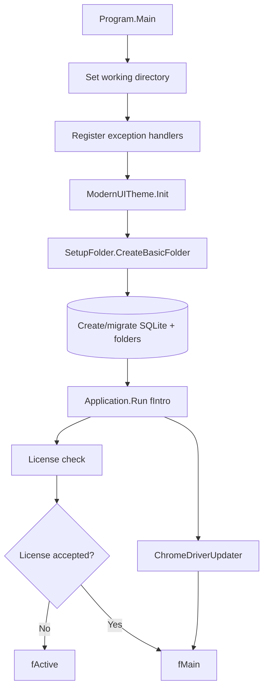
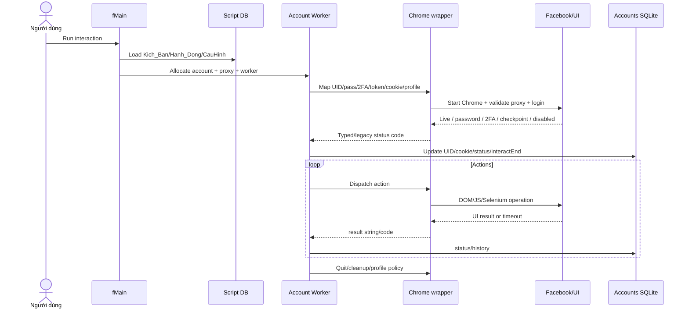
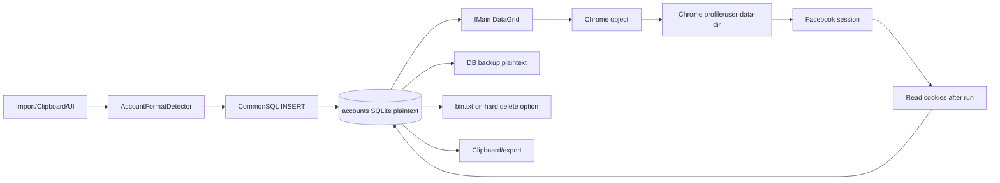

# Kiến trúc, luồng hệ thống và chức năng

## 1. Kiến trúc thực tế

| Lớp | Thành phần | Vai trò | Điểm yếu chính |
|---|---|---|---|
| Bootstrap | `Core/Program.cs`, `SetupFolder.cs`, `Forms/fIntro.cs` | Khởi tạo WinForms, thư mục/schema, splash, license, ChromeDriver | Ghi log trực tiếp; một số lỗi bị nuốt |
| UI + orchestration | `Forms/MainForm/fMain*.cs`, `Forms/fHD*.cs` | Quản lý account, script, worker, proxy, browser, action dispatch | God form, shared mutable state, Thread-based |
| Browser automation | `Browser/Chrome.cs`, `FacebookLoginAutofill.cs`, `AutoControl.cs` | Selenium, profile, proxy, cookie/login, DOM/JS, window control | God object, selector phụ thuộc DOM, patch driver |
| Business hubs | `Hub/*.cs`, `Helpers/*.cs` | Profile, Page, group, friend, posting, warm-up, checkpoint | Trùng logic, catch rỗng, false-success |
| Persistence | `ConnectorAccounts`, `ConnectorKichBan`, `CommonSQL`, `AccountGroupDB`, `KichBanThongKeDB` | SQLite account, script, group, history | DB path phân kỳ, SQL ghép chuỗi, giao dịch rời rạc |
| Config | `Legacy/GClass4.cs`, `settings/*.json` | Cấu hình key/value JSON | Không schema, ghi không atomic/không lock |
| Network/external | `Network/*`, MailKit, AI gateways | Proxy/HTTP, IMAP, Gemini/OpenAI/DeepSeek/Jev | TLS IMAP sai; endpoint/quota/DOM phụ thuộc ngoài |
| Tests | `Tests/TestModuleVerification*` | Console verification tự chế | Không nằm trong solution, dùng binary HintPath, suite bị loại |

## 2. Sơ đồ khởi động

Evidence: `Core/Program.cs:8-40`, `Core/SetupFolder.cs:151-360`, `Forms/fIntro.cs:106-236`.

## 3. Luồng chạy một tài khoản

Evidence: `Forms/MainForm/fMain.cs:1539-1639,2554-2574,3940-4489,5354-5499,10307-10327`.

## 4. Luồng dữ liệu credential

Credential copies are not centrally tracked or revoked. Evidence: `SetupFolder.cs:151-203`, `CommonSQL.cs:264-338,655-719`, `fMain.cs:2625-2742,5424-5453`, `Chrome.cs:931-960,3331-3406`, `DatabaseAutoBackupHub.cs:92-124`.

## 5. Data stores

| Store | Nội dung | Ghi chú |
|---|---|---|
| `database/db_lushcare.sqlite` (fallback `db_maxcare.sqlite`) | accounts/files | Main connector prefers lushcare |
| `interact/interact.sqlite` | scripts/actions/config JSON | Separate connector |
| `database/db_post.db` | topics/posts | Legacy connector |
| `account_groups`, `tai_khoan_kich_ban`, histories | group/script/history | Repositories may prefer/fan-out to different candidate DBs |
| `settings/*.json` | app/browser/AI/proxy settings | Whole-file overwrite |
| Chrome profiles | cookies/local storage/session | State outside database backup |
| Logs/output/bin.txt | diagnostics and exports | Can contain sensitive data |

## 6. Bản đồ chức năng

### Account lifecycle
- Import/detect format, folders, filter/search, batch update, soft delete/restore/hard delete.
- CookieVault conversion/import/export.
- Profile session, Chrome profile, cookie/password/TOTP login.
- Account health, quick selection, status/checkpoint tracking.

### Profile & security
- Bio, work, education, location, relationship, gender, birthday.
- Rename, avatar, cover, professional mode, profile lock.
- Password, 2FA, email/phone, trusted devices, checkpoint flows.

### Content & social workflows
- Status/wall/group/page/story/reel posting.
- Reactions, comments, shares, notifications, watch/story/reel.
- Friend request/confirm/cancel/unfriend and group join/leave/questions.
- Page creation, Pro5 switching, admin/full-control operations.
- Messaging and AI-assisted text/group-question generation.

### Operations
- Multi-script, multi-worker, proxy pools, scheduling UI, backup/restore.
- Gemini/OpenAI/DeepSeek gateways; Jev currently wired mainly to config/test, not all app workflows.

## 7. Implemented vs partially wired

| Capability | State |
|---|---|
| WinForms startup, SQLite, worker orchestration, Selenium login/actions | Implemented |
| Jev foundation + DPAPI + config/test | Implemented foundation, not broadly used in app actions |
| `fLenLichTuongTac2`, `fTienIchChatGPT`, `fHDBaiVietNewsfeed3` | Exists; UI/runtime reachability unclear |
| Share Page/Uptop/tagged-post buttons | Hidden/non-default |
| Extension bootstrap | Commented/disabled in current setup |
| DOM-dependent Facebook features | Source exists; runtime validation required |

## 8. Failure boundaries

- **Startup:** global handlers exist, but their file sink has no rotation/redaction.
- **SQLite:** WAL and locks help, but locks are per repository and paths can diverge.
- **Workers:** shared collections/UI controls and Thread lifecycle require stress testing.
- **Browser:** Selenium 3 + current ChromeDriver + DOM changes are a fragile boundary.
- **External services:** Facebook, IMAP, proxy providers and AI APIs require isolated integration tests.
- **License:** local Base64 payload is not a signed authorization boundary.
